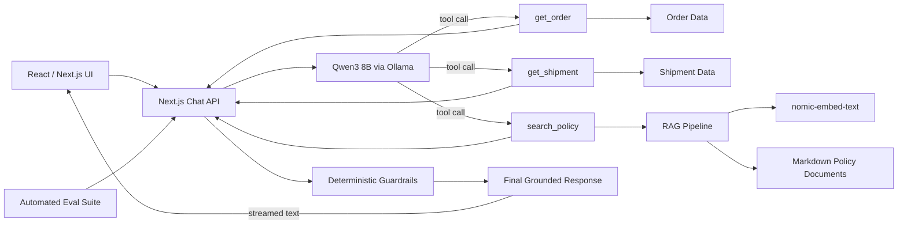

Local AI Customer Support Agent
A recruiter-friendly AI engineering project demonstrating how to build a grounded, tool-using customer support agent with Next.js, TypeScript, Ollama, Qwen3, RAG, conversational context, deterministic guardrails, streaming responses, and automated evaluations.
The goal of this project is not just to call an LLM. It shows how to build an application around an LLM so that responses are grounded in trusted data, important business rules are enforced deterministically, and quality can be measured with repeatable evaluations.
Demo
The agent can:

- Look up order details and shipment status
- Track packages using application data
- Retrieve refund, shipping, and return policies with RAG
- Answer follow-up questions using conversational context
- Resolve references such as “it” or “that order”
- Detect ambiguous references instead of guessing
- Enforce fresh shipment checks before refund decisions
- Stream the final response to the UI
- Recover cleanly from timeouts and backend failures
- Run automated evals for tool routing, answer quality, latency, and efficiency
  Example:
  User: Where is ORD-123?

Agent:
Your package with order ID ORD-123 is currently in transit with UPS.
The last known location is Dallas, TX, and it is estimated to arrive
by October 10, 2026.
Follow-up:
User: Can I get a refund?

Agent:
Uses conversation context to resolve ORD-123, retrieves current shipment
state and the relevant refund policy, then answers based only on those sources.
Ambiguity handling:
User: Compare ORD-123 and ORD-456.
User: Can I get a refund for it?

Agent:
Which order do you mean, ORD-123 or ORD-456?

## Architecture



### Request flow

```text
User message
    ↓
Conversation context
    ↓
LLM decides what information is needed
    ↓
Application executes read-only tools
    ↓
Order / shipment data + retrieved policy
    ↓
Deterministic guardrails validate required context
    ↓
LLM produces a grounded customer-facing answer
    ↓
Final response streams to the browser
```

---

## Why this project is interesting?

A basic LLM application might send a prompt and display the response.
This project adds the engineering layers needed for a more reliable agent.

1. Tool calling
   The model can select application functions instead of inventing operational data.
   Available tools include:
   get_order
   get_shipment
   search_policy
   The model chooses the tool and arguments, but the application executes the function.
   That separation is important: the LLM does not directly access application data.
2. Multi-step agent loop
   Some questions require more than one source.
   For example:
   Can I get a refund for ORD-123?
   may require:
   get_shipment(ORD-123)

- search_policy(refund eligibility for delayed shipment)
  The agent can gather multiple pieces of information before producing the final answer.
  Duplicate tool calls are detected so the model cannot loop indefinitely.

3. RAG for company policy
   Refund, return, and shipping policies are stored as Markdown documents.
   The application:
1. Splits policy documents into chunks
1. Creates embeddings with nomic-embed-text
1. Embeds the user's policy question
1. Calculates cosine similarity
1. Returns the most relevant policy chunks
1. Gives those chunks to the model as trusted context
   The model is instructed not to answer policy questions from memory.
   Example policy files:
   src/data/policies/
   ├── refund-policy.md
   ├── returns-policy.md
   └── shipping-policy.md
1. Conversational context
   The frontend sends the prior conversation with each request.
   That allows interactions such as:
   User: Where is ORD-123?
   Agent: ...

User: Can I get a refund?
The agent understands that the second question still refers to ORD-123.
The application also distinguishes between:
conversation memory
and:
fresh operational data
Previous assistant responses may help identify which order the user means, but they are not treated as authoritative current shipment state. 5. Deterministic guardrails
Some behavior is too important to leave entirely to probabilistic model reasoning.
Missing order ID
User: Where is my package?
The application responds:
Please provide your order ID.
instead of allowing the model to invent one.
Ambiguous reference
User: Compare ORD-123 and ORD-456.
User: Can I get a refund for it?
The application responds:
Which order do you mean, ORD-123 or ORD-456?
instead of guessing.
Refund freshness
A refund decision requires:
current shipment state

- retrieved refund policy
  If the model attempts to answer without fresh shipment data, the application retrieves it before accepting the final response.
  This is one of the core design principles in the project:
  Use the LLM for language and flexible reasoning. Use deterministic application logic for rules that must not be guessed.

## Grounding rules

The agent is instructed to:

- Use tool results and retrieved policy as the source of truth
- Avoid inventing shipment details
- Avoid inventing refund rules
- Avoid inventing support phone numbers or websites
- Avoid inventing escalation paths
- Avoid claiming actions were performed when no action capability exists
- Keep order status and shipment status separate
- Ask for clarification when references are ambiguous
  Streaming
  Tool selection remains non-streaming because the application needs complete structured tool calls.
  The final customer-facing response is streamed.
  Tool planning
  ↓
  Tool execution
  ↓
  Required context gathered
  ↓
  stream:true
  ↓
  React progressively updates the assistant bubble
  This improves perceived latency while keeping tool execution predictable.
  Error handling
  Ollama requests use an application-level timeout.
  Current behavior:
  Successful Ollama request
  → HTTP 200

Ollama takes too long
→ HTTP 504

Unexpected backend failure
→ HTTP 500
The UI receives user-friendly error messages rather than raw backend exceptions.
Automated evaluation
The project includes an eval suite rather than relying only on manual testing.
Run:
npx tsx scripts/run-evals.ts
The suite measures:

- Required tool selection
- Tool arguments
- Answer quality
- Required answer content
- Forbidden / unsupported answer content
- Number of agent steps
- Extra tool calls
- End-to-end latency

## Current Qwen3 8B baseline

### EVAL SCORECARD

Overall: 8/8
Tool routing: 8/8
Answer quality: 8/8
Accuracy: 100%
Average steps: 2.0
Average latency: 5637 ms
Extra tool calls: 2
==========================
These evals cover cases including:
shipment lookup
order item lookup
refund eligibility
missing order ID
unknown order
multi-source questions
conversation memory
multi-order comparison
Model experiment: 8B vs 4B
The same eval framework was used to investigate model/runtime tradeoffs.
qwen3:8b produced the strongest end-to-end result for this application.
The smaller qwen3:4b model was tested as a potential latency optimization, but in the local Ollama setup it generated long reasoning traces before the final answer. This made it slower at the application level despite having fewer parameters.
That experiment reinforced an important lesson:
Smaller model size does not automatically mean lower end-to-end latency. Output length, tool behavior, runtime templates, and the number of inference passes also matter.

## Tech stack

Application

- Next.js
- React
- TypeScript
- Tailwind CSS
  AI
- Ollama
- Qwen3 8B
- nomic-embed-text
  Agent capabilities
- Native tool calling
- Multi-step agent loop
- RAG
- Conversation context
- Grounding
- Deterministic guardrails
- Streaming
  Quality
- Custom TypeScript eval runner
- Tool-routing evaluation
- Answer-quality evaluation
- Latency measurement
- Agent-step measurement
- Extra-tool-call tracking
  Project structure
  ai-support-agent/
  ├── scripts/
  │ └── run-evals.ts
  │
  ├── src/
  │ ├── app/
  │ │ ├── api/
  │ │ │ ├── chat/
  │ │ │ │ └── route.ts
  │ │ │ └── policy-search/
  │ │ │ └── route.ts
  │ │ │
  │ │ ├── globals.css
  │ │ ├── layout.tsx
  │ │ └── page.tsx
  │ │
  │ ├── data/
  │ │ └── policies/
  │ │ ├── refund-policy.md
  │ │ ├── returns-policy.md
  │ │ └── shipping-policy.md
  │ │
  │ ├── evals/
  │ │ └── evalCases.ts
  │ │
  │ └── lib/
  │ ├── orders.ts
  │ ├── shipments.ts
  │ └── policySearch.ts
  │
  ├── package.json
  ├── tsconfig.json
  └── README.md

  ## Running locally

1. Install Node dependencies
   npm install
   This project was developed and tested with Node.js 22.
2. Install Ollama
   Install Ollama for your platform, then pull the required models:
   ollama pull qwen3:8b
   ollama pull nomic-embed-text
   Verify:
   ollama list
3. Start the application
   OLLAMA_MODEL=qwen3:8b npm run dev
   Then open:
   http://localhost:3000
   Running the eval suite
   Keep the application running, then in another terminal:
   npx tsx scripts/run-evals.ts
   The runner sends fixed test cases to:
   POST /api/chat
   and compares actual tool behavior and answer quality against expected behavior.
   Example API request
   Non-streaming:
   curl -X POST http://127.0.0.1:3000/api/chat -H 'Content-Type: application/json' -d '{
   "messages": [
   {
   "role": "user",
   "content": "Where is ORD-123?"
   }
   ]
   }'
   Streaming:
   curl -N -X POST http://127.0.0.1:3000/api/chat -H 'Content-Type: application/json' -d '{
   "stream": true,
   "messages": [
   {
   "role": "user",
   "content": "Where is ORD-123?"
   }
   ]
   }'

   ## Key engineering lessons

   LLMs should not be the database.
   Operational facts come from application tools.
   RAG retrieval quality matters.
   A model can reason correctly over the wrong retrieved context and still produce the wrong answer.
   Prompting is not enough for every rule.
   Important invariants such as ambiguous order handling and refund freshness are safer as deterministic application logic.
   Conversation context and current state are different.
   History is useful for resolving references; operational decisions should use fresh data.
   Evaluate behavior, not just prose.
   A response can sound correct while using the wrong tool or stale information.
   Measure model choices end-to-end.
   A smaller model is not necessarily faster once reasoning length, tool loops, and runtime behavior are included.
   Possible future improvements

- Persist conversations in SQLite/PostgreSQL
- Add authentication
- Add real order/shipping APIs
- Add action tools for cancellations, refunds, and returns
- Add tracing with OpenTelemetry
- Add structured production logging
- Store eval history for regression analysis
- Add CI to run evals automatically
- Add a hosted model option
- Add broader policy datasets
- Add human-review / escalation workflows
  Resume summary
  Built a local AI customer-support agent with Next.js, TypeScript, Qwen3/Ollama, tool calling and RAG; implemented conversational context, deterministic grounding guardrails, streaming responses, timeout/error handling, and an automated evaluation suite achieving 100% accuracy across core tool-routing and response-quality scenarios.

## About

This project was built as a hands-on exploration of production-oriented AI application engineering: combining LLM reasoning with application tools, retrieval, guardrails, evaluation, and frontend/backend product behavior.
